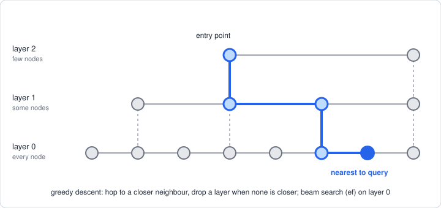
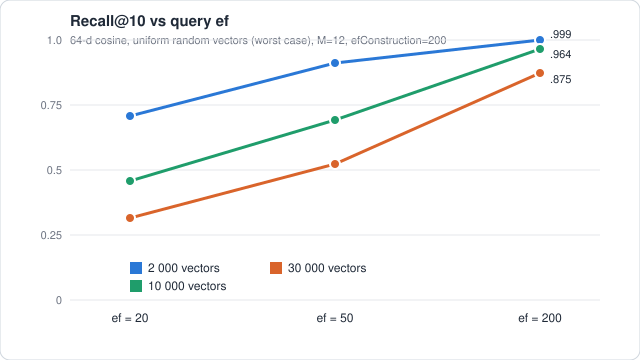
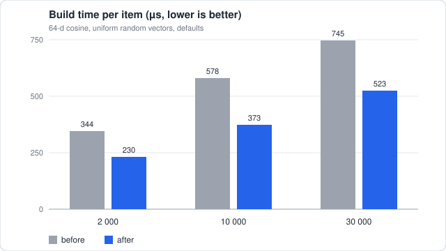

# Cassini

A pure TypeScript port of [Spotify Voyager](https://github.com/spotify/voyager),
the HNSW approximate-nearest-neighbour library. No native code, no WASM, zero
dependencies; runs in Node, Bun and the browser.

```
npm install cassini-hnsw
```

Plain ESM JavaScript with `.d.ts` types; runs on Node 18+, Bun and bundlers.

```ts
import { Cassini, mmrRerank } from 'cassini-hnsw'

const index = new Cassini({ space: 'cosine', numDimensions: 64, randomSeed: 1 })
index.addItems(vectors)                      // ids are insertion order: 0, 1, 2…
const { ids, distances } = index.query(q, 10)           // best first
const similar = index.queryById(42, 10)                 // self excluded

const bytes = index.toSnapshot()             // save / get_serialized_index
const restored = Cassini.fromSnapshot(bytes)
```

Snapshots store the seed and are validated on load (truncated or corrupt bytes
throw instead of reading out of bounds); inserts after a restore continue
exactly as the original build would have.

Distances are smaller = closer in every space; `euclidean` is squared L2.
`cosine` normalizes vectors on the way in.

## How it works



## What's the same as Voyager

Spaces `cosine` / `euclidean` / `dot`; the HNSW core from `hnswalg.h`
(randomized levels, `efConstruction` beam search, heuristic neighbour
selection with keep-pruned fill, M / 2M link caps); defaults M=12,
efConstruction=200, `queryEf` falling back to `efConstruction`.

## What's different

- **Deterministic.** Seeded RNG and id-tie-broken heaps: same vectors + seed
  gives an identical graph.
- **`mmrRerank`.** Maximal-marginal-relevance re-ranking for diverse results.
- **Append-only.** No delete, update or explicit ids; rebuild to change items.
- No HIK space or MinHash LSH.

## Performance

64-d cosine, uniform random vectors (the hardest case for HNSW; real data
clusters and does better), defaults, k=10:

| N | build | recall @ ef=200 | query @ ef=200 |
| --- | --- | --- | --- |
| 2 000 | 0.23 ms/item | 0.999 | 4 900 qps |
| 10 000 | 0.37 ms/item | 0.964 | 2 900 qps |
| 30 000 | 0.52 ms/item | 0.875 | 1 700 qps |





Brute force takes about 2 ms/query at 10k, so below a few thousand vectors
the index buys little over a linear scan.

## Development

```
bun install
bun test
bun run typecheck
bun run build && npm run smoke   # builds dist/, then checks it under plain Node
```

Apache-2.0; derived from Voyager, see `NOTICE`.
